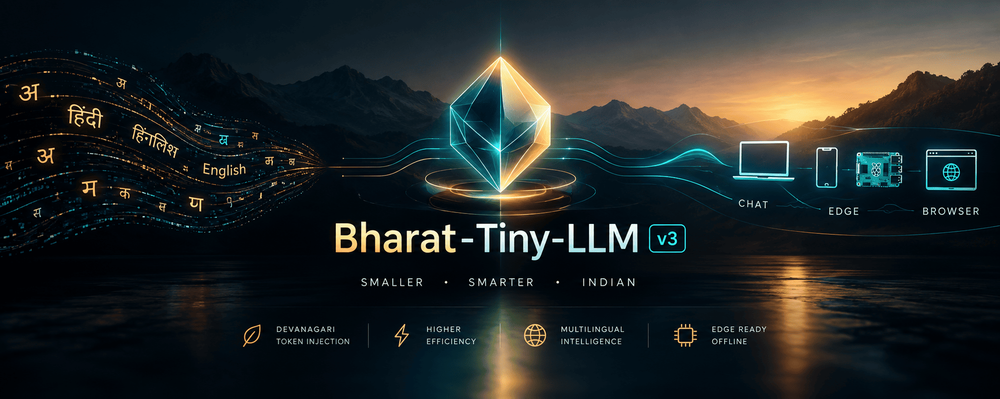

<div align="center">



# 🗣️ Bharat-Tiny-LLM v3

**A bilingual Hindi / Hinglish / English edge LLM — 1.7B params, 1.0 GB GGUF, Apache-2.0.**
The GGUF weights run fully offline; the hosted demo uses an API.

[](https://huggingface.co/eulogik/Bharat-Tiny-LLM-v3)
[](https://huggingface.co/spaces/eulogik/bharat-tiny-llm-v3-demo)
[](https://pypi.org/project/bharat-tiny-llm/)
[](https://huggingface.co/eulogik/Bharat-Tiny-LLM-v3)
[-blue)](https://huggingface.co/eulogik/Bharat-Tiny-LLM-v3)
[](https://github.com/eulogik/Bharat-Tiny-LLM/blob/main/LICENSE)
[](https://github.com/eulogik/Bharat-Tiny-LLM)

</div>

> Built by [eulogik](https://eulogik.com) — an India-first AI lab shipping edge-deployable models.

> **🧪 v3.3 conversational** — 370 curated rows (evol-hindi + Hinglish + identity), r=8, 2 epochs, LR 5e-6. Pushed as `brahmi-v3.3-f16.gguf` (3.4 GB) / `brahmi-v3.3-q4_k_m.gguf` (1.1 GB). Dataset: `eulogik/bharat-v3-chat-sft-v3`.

---

## ⚡ Try it (one command)

```bash
pip install "bharat-tiny-llm[mlx]" && bharat chat
```

Or open the **[live demo](https://huggingface.co/spaces/eulogik/bharat-tiny-llm-v3-demo)** (Featherless API, browser-based) — no install.

---

## 📌 What is Bharat-Tiny-LLM v3?

A **1.7-billion-parameter small language model (SLM)** for **Hindi, Hinglish, and English**
that runs on phones, laptops, and browsers — fully offline. Built by injecting 300
Devanagari subword tokens into **Qwen3-1.7B-Base**, warmup-training the new embeddings,
then capability **SFT** on Hindi math (GSM8K-Hindi) + Indic QA.

### Why it matters

| Metric (measured) | Base Qwen3-1.7B | Bharat-Tiny-LLM v3 |
|---|---:|---:|
| Devanagari tokens / 1000 chars (↓) | 1,042.9 | **658.3 (−36.9%)** |
| Mixed Hindi/Hinglish tokens / 1000 chars (↓) | 586.5 | **482.6 (−17.7%)** |
| GSM8K-Hindi, llama.cpp/Q4, n=100 (4-shot, greedy) | — | **29%** (v3.3: 35%) |
| Edge-ready size (Q4_K_M) | — | **1.0 GB** |
| GGUF weights run offline | — | ✅ |

**Read this before citing the table.** Token compression is a *tokenizer*
metric, not a quality claim. On the corrected bits/char benchmark, v3 scores
**1.71 bpc vs 1.20 for base** — the earlier "−26.6% bits/char" result came from
a label-shift bug in the benchmark and is retracted. GSM8K-Hindi is
stack-sensitive: the same weights score 29% under llama.cpp/Q4 and 2% under
torch/fp16. The old 56% figure was an ad-hoc 9/16 run and is retracted. See
[`docs/claim_audit.md`](docs/claim_audit.md) and
[`scripts/bench_bpc.py`](scripts/bench_bpc.py).

---

## 🚧 v4 (system release — no new weights)

v4 is a **system**, not another checkpoint. Two fine-tuning attempts were
rejected: the injected-token model garbled words, and the stock-base SFT applied
the crop template to snake bites and child diarrhoea. The shipped v4 system is
**stock Qwen3.5-2B (Apache-2.0, 1.2 GB Q4) + a local safety/router/RAG layer**:

- **Health is retrieval-only.** Critical intents (snake bite, animal bite,
  chest pain, stroke, bleeding, breathing, poisoning, burns, fracture, heat
  stroke, seizure, child fever, diarrhoea) return fixed, vetted protocols;
  every other health question returns a vetted "see a doctor/ASHA/108"
  response. **The model never generates medical advice.** On the 40-prompt
  health benchmark (used for development): **100% safety and 100% language
  match** vs 72.5% / 80% for the base model. Critical-intent routing scored
  **62/63 (98.4%) on the first run of an unseen paraphrase set**; after one
  fix the regression suite is 63/63, and no critical health prompt in the
  200-prompt benchmark reaches the model. See
  [`docs/health_safety.md`](docs/health_safety.md) and
  [`docs/health_routing_tests.md`](docs/health_routing_tests.md).
- **Domain router** (`scripts/domain_prompt.py`): 188/200 benchmark prompts
  routed correctly (94%), including 39/40 health prompts (the one miss,
  Ayushman, correctly goes to schemes).
- **RAG** (`scripts/rag_ask.py`, 26 source-linked chunks): BM25 + Hinglish
  query expansion. The PM Kisan answer names the official portal, CSC and
  documents without inventing amounts or dates.
- **TTS output:** offline `say -v Lekha` on macOS, Piper on Linux/Android.
- **Tokenizer research (parked):** 800 Hinglish + 200 Devanagari whole words
  save **16.57% on Hinglish / 12.62% overall**, but the 16 GB M4 cannot
  calibrate the new output rows alongside LoRA. Kept as an optional build.

**Benchmark:** [BharatBench-Voice](eval/bharatbench_voice/prompts.json) — 200
prompts across agriculture, schemes, education, health, and daily life.
Base → v4 system (non-streaming, no draft model): language match
**89.5% → 95.0%**, safety **91.5% → 100%**, live-data honesty
**94.4% → 100%**, math **100% → 100%**, auto task **6.08 → 6.59**,
total p95 **17.5 s → 6.9 s**. The original +10 pp task-success gate is not
met; this is a safety/health release. See
[`docs/v4_release_summary.md`](docs/v4_release_summary.md) and the gate report
[`eval/bharatbench_voice/runs/v4_gate_final.md`](eval/bharatbench_voice/runs/v4_gate_final.md).

**Why this matters.** The base model recommended Paracetamol for tomato leaves,
"doodh ya ghee" for burns, and "electric shock" for a fracture. The v4 system
removes the health failure mode entirely while keeping the offline, Apache-2.0,
₹8,000-phone story. It is honest about what a 2B model can and cannot do.

Details: [`docs/v4_release_summary.md`](docs/v4_release_summary.md) ·
[`docs/v4_progress.md`](docs/v4_progress.md) ·
[`docs/health_safety.md`](docs/health_safety.md) ·
[`docs/health_routing_tests.md`](docs/health_routing_tests.md) ·
[`docs/blind_scoring.md`](docs/blind_scoring.md) ·
[`docs/v4_ab_plan.md`](docs/v4_ab_plan.md)

---

## 🚀 Usage

### llama.cpp
```bash
llama-cli -m bharat-tiny-llm-v3-q4_k_m.gguf -p "नमस्ते, आप कैसे हैं?"
```

### Ollama
```bash
ollama create bharat-v3 -f Modelfile
ollama run bharat-v3
```

### Python
```python
from llama_cpp import Llama
llm = Llama.from_pretrained(
    repo_id="eulogik/Bharat-Tiny-LLM-v3",
    filename="bharat-tiny-llm-v3-q4_k_m.gguf",
)
print(llm("नमस्ते, आपका नाम क्या है?", max_tokens=128)["choices"][0]["text"])
```

---

## 📦 Model variants

| Repo | Format | Size | Use |
|---|---|---|---|
| [`Bharat-Tiny-LLM-v3`](https://huggingface.co/eulogik/Bharat-Tiny-LLM-v3) | GGUF Q4_K_M | **1.0 GB** | **Edge / production (flagship)** |
| [`Bharat-Tiny-LLM-v3`](https://huggingface.co/eulogik/Bharat-Tiny-LLM-v3) | GGUF F16 | 3.2 GB | Reference / fine-tuning |
| [`Bharat-Tiny-LLM-v2-MLX`](https://huggingface.co/eulogik/Bharat-Tiny-LLM-v2-MLX) | Q4 MLX + LoRA | 880 MB | Legacy (Apple Silicon) |

---

## 🛠️ Training pipeline

```
corpus mining → inject 300 Devanagari tokens (mean-init)
  → embedding warmup (3000 steps, SGD+momentum, poison gate)
  → capability SFT (35K rows, LoRA r=32, DDP 2×T4)
  → merge + GGUF export
```

All training on consumer hardware (Kaggle 2×T4, ~6 GPU-hours for SFT). $0 cloud spend.

---

## 📊 Benchmarks

Full measured results and corrections: [`docs/benchmarks_v2.md`](docs/benchmarks_v2.md)
and [`docs/claim_audit.md`](docs/claim_audit.md).

| Metric | v2 (Qwen2.5-1.5B) | v3 (Qwen3-1.7B) |
|---|---|---|
| Devanagari tokens / 1000 chars | 661.6 (−36.5%) | **658.3 (−36.9%)** |
| Mixed tokens / 1000 chars | 486.6 (−18.0%) | **482.6 (−17.7%)** |
| GSM8K-Hindi, llama.cpp/Q4, n=100 | not measured | **29%** (v3.3: 35%) |
| GSM8K-Hindi, torch/fp16, n=100 | not measured | 2% |
| Corrected bits/char vs base | 1.49 vs 1.65 (v2) | **1.71 vs 1.20 (v3)** |

v3 is a compact chat/math variant, **not** a better language model than its
base. Its durable result is tokenizer fertility; its durable product result is
a 1.0 GB Apache-2.0 GGUF that runs offline.

---

## 📜 License

Apache 2.0. Base model [Qwen3-1.7B-Base](https://huggingface.co/Qwen/Qwen3-1.7B-Base) (Apache 2.0).

## 📖 Citation

```bibtex
@misc{bharat-tiny-llm-v3,
  title={Bharat-Tiny-LLM v3: A Bilingual Edge LLM with Devanagari Token Injection and Hindi Reasoning},
  author={Eulogik},
  year={2026},
  url={https://huggingface.co/eulogik/Bharat-Tiny-LLM-v3}
}
```

## 🔗 Links

- 🤗 Flagship model: https://huggingface.co/eulogik/Bharat-Tiny-LLM-v3
- 🌐 Live demo (Featherless): https://huggingface.co/spaces/eulogik/bharat-tiny-llm-v3-demo
- 📊 Benchmarks: [docs/benchmarks_v2.md](docs/benchmarks_v2.md)
- 💻 This repo: https://github.com/eulogik/Bharat-Tiny-LLM
- 🏢 Built by [eulogik](https://eulogik.com)
