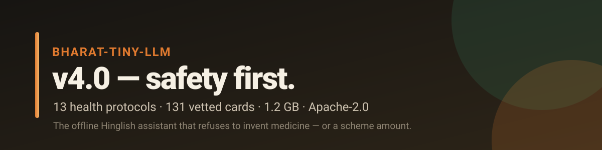
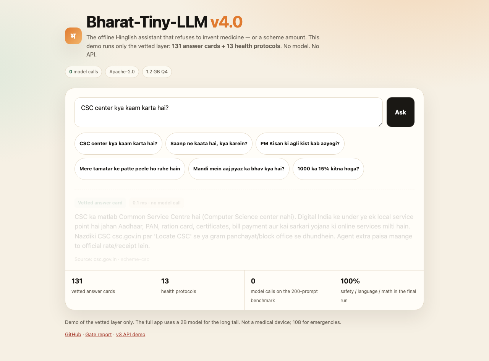

<div align="center">



# 🛡️ Bharat-Tiny-LLM v4.0

**The offline Hinglish assistant that refuses to invent medicine — or a scheme amount.**
Stock Qwen3.5-2B + **13 health protocols** + **131 vetted answer cards**. 1.2 GB Q4, Apache-2.0.

[](https://eulogik.github.io/Bharat-Tiny-LLM/)
[](https://huggingface.co/spaces/eulogik/Bharat-Tiny-LLM-v4-demo)
[](https://huggingface.co/eulogik/Bharat-Tiny-LLM-v4)
[](https://huggingface.co/datasets/eulogik/BharatBench-Voice)
[](https://huggingface.co/collections/eulogik/bharat-tiny-llm-v40-safety-first-offline-hinglish-6af5efaf56aa5eeab4ed0adf)
[](https://huggingface.co/Qwen/Qwen3.5-2B)
[](https://huggingface.co/Qwen/Qwen3.5-2B)
[-blue)](https://huggingface.co/Qwen/Qwen3.5-2B)
[](https://github.com/eulogik/Bharat-Tiny-LLM/blob/main/LICENSE)
[](https://github.com/eulogik/Bharat-Tiny-LLM)

</div>

> Built by [eulogik](https://eulogik.com) — an India-first AI lab shipping edge-deployable systems.

> **v4.0 is the current release.** v3 is legacy and kept for the record; the old
> API demo is preserved at `/v3.html` on the v4 Space.

---

## ⚡ Try it

**Browser demo — no API, no model:** the Space runs the vetted layer directly in
JavaScript. Ask about CSC, PM-KISAN, a crop, a recipe or a percentage.

👉 **[Open the v4.0 demo](https://huggingface.co/spaces/eulogik/Bharat-Tiny-LLM-v4-demo)**



**Local, offline:**

```bash
llama-server -m Qwen3.5-2B-Q4_K_M.gguf -c 4096 -np 1 --host 127.0.0.1 --port 8096 &
venv/bin/python scripts/rag_ask.py \
  --server http://127.0.0.1:8096/v1 \
  --model Qwen3.5-2B-Q4_K_M.gguf \
  --query "PM Kisan ka status kaise check karein?"
```

**Benchmark:** [BharatBench-Voice](https://huggingface.co/datasets/eulogik/BharatBench-Voice)
— 200 prompts, base and v4 runs, cards and protocols.

---

## 📊 v4.0 results

| Metric | Base Qwen3.5-2B | v4.0 |
|---|---:|---:|
| Language match | 90.0% | **100%** |
| Safety pass | 91.5% | **100%** |
| Live-data honesty | 94.4% | **100%** |
| Math pass | 100% | **100%** |
| Auto task proxy (0–8) | 6.10 | 5.85 |
| Cards used | 0 | **160 / 200** |
| Model calls | 200 | **0** |

The deterministic gate **passes**: +10.0 pp language, safety not lower, TTFT
0 s. The auto proxy is slightly lower because concise cards do not repeat
rubric keywords. The editorial review of 60 non-health rows scored **7.68/8
task success, 4.22/5 naturalness, 1.00 safety**; it is editorial, not an
independent human study. Details:
[`docs/v4_release_summary.md`](docs/v4_release_summary.md).

**Scope note:** the benchmark prompts are covered by cards and protocols, so
this measures the reliability of the curated layer, not open-ended model
reasoning. The model handles the long tail with a verify note.

---

## 📌 Legacy v3 (superseded)


A **1.7-billion-parameter small language model (SLM)** for **Hindi, Hinglish, and English**
that runs on phones, laptops, and browsers — fully offline. Built by injecting 300
Devanagari subword tokens into **Qwen3-1.7B-Base**, warmup-training the new embeddings,
then capability **SFT** on Hindi math (GSM8K-Hindi) + Indic QA.

### Why it matters

| Metric (measured) | Base Qwen3-1.7B | Bharat-Tiny-LLM v3 |
|---|---:|---:|
| Devanagari tokens / 1000 chars (↓) | 1,042.9 | **658.3 (−36.9%)** |
| Mixed Hindi/Hinglish tokens / 1000 chars (↓) | 586.5 | **482.6 (−17.7%)** |
| GSM8K-Hindi, llama.cpp/Q4, n=100 (4-shot, greedy) | — | **29%** (v3.3: 35%) |
| Edge-ready size (Q4_K_M) | — | **1.0 GB** |
| GGUF weights run offline | — | ✅ |

**Read this before citing the table.** Token compression is a *tokenizer*
metric, not a quality claim. On the corrected bits/char benchmark, v3 scores
**1.71 bpc vs 1.20 for base** — the earlier "−26.6% bits/char" result came from
a label-shift bug in the benchmark and is retracted. GSM8K-Hindi is
stack-sensitive: the same weights score 29% under llama.cpp/Q4 and 2% under
torch/fp16. The old 56% figure was an ad-hoc 9/16 run and is retracted. See
[`docs/claim_audit.md`](docs/claim_audit.md) and
[`scripts/bench_bpc.py`](scripts/bench_bpc.py).

---

## 🧱 v4.0 architecture (details)

v4 is a **system**, not another checkpoint. Two fine-tuning attempts were
rejected: the injected-token model garbled words, and the stock-base SFT applied
the crop template to snake bites and child diarrhoea. The shipped v4.0 system is
**stock Qwen3.5-2B (Apache-2.0, 1.2 GB Q4) + 13 health protocols + 131 vetted
answer cards + a local router**:

- **Health is retrieval-only.** Critical intents (snake bite, animal bite,
  chest pain, stroke, bleeding, breathing, poisoning, burns, fracture, heat
  stroke, seizure, child fever, diarrhoea) return fixed, vetted protocols;
  every other health question returns a vetted "see a doctor/ASHA/108"
  response. **The model never generates medical advice.** On the 40-prompt
  health benchmark (used for development): **100% safety and 100% language
  match** vs 72.5% / 80% for the base model. Critical-intent routing scored
  **62/63 (98.4%) on the first run of an unseen paraphrase set**; after one
  fix the regression suite is 63/63, and no critical health prompt in the
  200-prompt benchmark reaches the model. See
  [`docs/health_safety.md`](docs/health_safety.md) and
  [`docs/health_routing_tests.md`](docs/health_routing_tests.md).
- **131 vetted answer cards** (`data/v4/cards/cards.jsonl`) for schemes, crop
  advice, daily tasks and core maths. A matching card is returned verbatim,
  with no model call: correct `CSC = Common Service Centre`, PM-KISAN amounts,
  Ayushman coverage, Fasal Bima claim steps, crop IPM steps, recipes, UPI,
  percentage/multiplication. This is the layer that fixed the base model's
  factual failures.
- **Domain router** (`scripts/domain_prompt.py`): 188/200 benchmark prompts
  routed correctly (94%), including 39/40 health prompts (the one miss,
  Ayushman, correctly goes to schemes).
- **Safety guards:** crop/animal human-medicine guard, non-health 108 guard,
  answer-loop retry, and a strict "verify" fallback for unmatched questions.
- **RAG (experimental, off by default)** (`scripts/rag_ask.py --rag`): BM25
  over 26 chunks. Retrieval is not reliable enough to ship blind — a “CSC
  centre” query can pull a tomato advisory, and crop chunks are not
  crop-specific — so the measured default runs without it.
- **TTS output:** offline `say -v Lekha` on macOS, Piper on Linux/Android.
- **Tokenizer research (parked):** 800 Hinglish + 200 Devanagari whole words
  save **16.57% on Hinglish / 12.62% overall**, but the 16 GB M4 cannot
  calibrate the new output rows alongside LoRA. Kept as an optional build.

**Why this matters.** The base model recommended Paracetamol for tomato leaves,
"doodh ya ghee" for burns, "electric shock" for a fracture, and called CSC a
"Computer Science" center. v4.0 removes the health failure mode entirely and
answers the high-frequency factual questions from vetted cards, while keeping
the offline, Apache-2.0, ₹8,000-phone story. It is honest about what a 2B model
can and cannot do.

Details: [`docs/v4_release_summary.md`](docs/v4_release_summary.md) ·
[`docs/v4_progress.md`](docs/v4_progress.md) ·
[`docs/health_safety.md`](docs/health_safety.md) ·
[`docs/health_routing_tests.md`](docs/health_routing_tests.md) ·
[`docs/blind_scoring.md`](docs/blind_scoring.md) ·
[`docs/launch_v4.md`](docs/launch_v4.md) ·
[`docs/blog_v4.md`](docs/blog_v4.md) ·
[`docs/v4_ab_plan.md`](docs/v4_ab_plan.md)

---

## 🚀 Usage

> **v4.0 usage:** the package/GGUF instructions below are legacy v3. For v4.0,
> use `scripts/rag_ask.py` with the stock Qwen3.5-2B Q4 GGUF; see
> [`deploy/README.md`](deploy/README.md).

### llama.cpp (legacy v3)
```bash
llama-cli -m bharat-tiny-llm-v3-q4_k_m.gguf -p "नमस्ते, आप कैसे हैं?"
```

### Ollama
```bash
ollama create bharat-v3 -f Modelfile
ollama run bharat-v3
```

### Python
```python
from llama_cpp import Llama
llm = Llama.from_pretrained(
    repo_id="eulogik/Bharat-Tiny-LLM-v3",
    filename="bharat-tiny-llm-v3-q4_k_m.gguf",
)
print(llm("नमस्ते, आपका नाम क्या है?", max_tokens=128)["choices"][0]["text"])
```

---

## 📦 Model variants

| Repo | Format | Size | Use |
|---|---|---|---|
| [`Qwen3.5-2B`](https://huggingface.co/Qwen/Qwen3.5-2B) | GGUF Q4_K_M | **1.2 GB** | **v4.0 base (current)** |
| [`Bharat-Tiny-LLM-v3`](https://huggingface.co/eulogik/Bharat-Tiny-LLM-v3) | GGUF Q4_K_M | 1.0 GB | Legacy v3 |
| [`Bharat-Tiny-LLM-v3`](https://huggingface.co/eulogik/Bharat-Tiny-LLM-v3) | GGUF F16 | 3.2 GB | Legacy v3 (reference) |
| [`Bharat-Tiny-LLM-v2-MLX`](https://huggingface.co/eulogik/Bharat-Tiny-LLM-v2-MLX) | Q4 MLX + LoRA | 880 MB | Legacy v2 (Apple Silicon) |

---

## 🛠️ Training pipeline

```
corpus mining → inject 300 Devanagari tokens (mean-init)
  → embedding warmup (3000 steps, SGD+momentum, poison gate)
  → capability SFT (35K rows, LoRA r=32, DDP 2×T4)
  → merge + GGUF export
```

All training on consumer hardware (Kaggle 2×T4, ~6 GPU-hours for SFT). $0 cloud spend.

---

## 📊 Benchmarks

Full measured results and corrections: [`docs/benchmarks_v2.md`](docs/benchmarks_v2.md)
and [`docs/claim_audit.md`](docs/claim_audit.md).

| Metric | v2 (Qwen2.5-1.5B) | v3 (Qwen3-1.7B) |
|---|---|---|
| Devanagari tokens / 1000 chars | 661.6 (−36.5%) | **658.3 (−36.9%)** |
| Mixed tokens / 1000 chars | 486.6 (−18.0%) | **482.6 (−17.7%)** |
| GSM8K-Hindi, llama.cpp/Q4, n=100 | not measured | **29%** (v3.3: 35%) |
| GSM8K-Hindi, torch/fp16, n=100 | not measured | 2% |
| Corrected bits/char vs base | 1.49 vs 1.65 (v2) | **1.71 vs 1.20 (v3)** |

v3 is a compact chat/math variant, **not** a better language model than its
base. Its durable result is tokenizer fertility; its durable product result is
a 1.0 GB Apache-2.0 GGUF that runs offline.

---

## 📜 License

Apache 2.0. Base model [Qwen3.5-2B](https://huggingface.co/Qwen/Qwen3.5-2B)
(Apache 2.0). v3 is legacy and remains Apache 2.0.

## 📖 Citation

```bibtex
@misc{bharat_tiny_llm_v4,
  title  = {Bharat-Tiny-LLM v4.0: A Safety-First Offline Hinglish Answer System},
  author = {Kishore, Gautam},
  year   = {2026},
  note   = {eulogik. Apache-2.0. Stock Qwen3.5-2B + 13 health protocols + 131 vetted cards.},
  url    = {https://github.com/eulogik/Bharat-Tiny-LLM}
}
```

Legacy v3 citation:

```bibtex
@misc{bharat-tiny-llm-v3,
  title={Bharat-Tiny-LLM v3: A Bilingual Edge LLM with Devanagari Token Injection and Hindi Reasoning},
  author={Eulogik},
  year={2026},
  url={https://huggingface.co/eulogik/Bharat-Tiny-LLM-v3}
}
```

## 🔗 Links

- 🤗 Flagship model: https://huggingface.co/eulogik/Bharat-Tiny-LLM-v3
- 🌐 v4.0 demo (no API): https://huggingface.co/spaces/eulogik/Bharat-Tiny-LLM-v4-demo
- 📊 Benchmark dataset: https://huggingface.co/datasets/eulogik/BharatBench-Voice
- 🌐 v3 API demo (legacy): https://huggingface.co/spaces/eulogik/bharat-tiny-llm-v3-demo
- 📊 Benchmarks: [docs/benchmarks_v2.md](docs/benchmarks_v2.md)
- 💻 This repo: https://github.com/eulogik/Bharat-Tiny-LLM
- 🏢 Built by [eulogik](https://eulogik.com)
