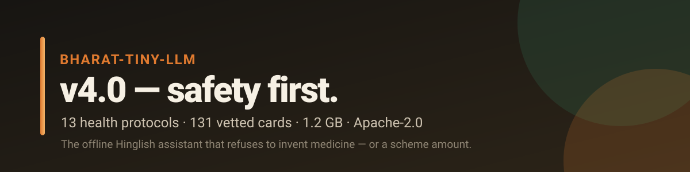

<div align="center">



# 🛡️ Bharat-Tiny-LLM v4.0

**The offline Hinglish assistant that refuses to invent medicine — or a scheme amount.**

Stock Qwen3.5-2B + **13 health protocols** + **131 vetted answer cards**.
1.2 GB Q4_K_M. Apache-2.0. Runs offline.

[](https://huggingface.co/eulogik/Bharat-Tiny-LLM-v4)
[](https://huggingface.co/spaces/eulogik/Bharat-Tiny-LLM-v4-demo)
[](https://huggingface.co/datasets/eulogik/BharatBench-Voice)
[](https://huggingface.co/collections/eulogik/bharat-tiny-llm-v40-safety-first-offline-hinglish-6af5efaf56aa5eeab4ed0adf)
[](https://github.com/eulogik/Bharat-Tiny-LLM)
[](https://huggingface.co/Qwen/Qwen3.5-2B)
[-blue)](https://huggingface.co/Qwen/Qwen3.5-2B)
[](#-safety)
[](https://github.com/eulogik/Bharat-Tiny-LLM/blob/main/LICENSE)

</div>

> **This is a system release, not a new checkpoint.** The weights are stock
> Qwen3.5-2B. The contribution is the safety/router/card layer and the public
> benchmark. No fine-tuned weights are claimed.

---

## ⚡ Quick answer

**What is it?** An offline Hinglish/Hindi/English assistant for rural India. It
answers health questions from 13 fixed first-aid protocols and common factual
questions from 131 vetted cards. The 2B model handles the long tail.

**Why does it matter?** A 2B model is fluent but unsafe on facts. It told a
snake-bite victim to band the wound, recommended “doodh ya ghee” for burns,
called CSC a “Computer Science” center, and told a ration-card user to call
108. v4.0 removes model generation from those paths.

**Headline result:** 100% language match, 100% safety, 100% live-data honesty
and 100% math on BharatBench-Voice, with **zero model calls**.

**Size / license:** 1.2 GB Q4_K_M, Apache-2.0, offline with llama.cpp.

---

## 📚 Table of contents

- [At a glance](#-at-a-glance)
- [How it works](#-how-it-works)
- [Health safety](#-health-safety)
- [131 vetted answer cards](#-131-vetted-answer-cards)
- [Benchmark results](#-benchmark-results)
- [Use it](#-use-it)
- [Safety and limitations](#-safety-and-limitations)
- [FAQ](#-faq)
- [Citation](#-citation)
- [License](#-license)

---

## 📊 At a glance

| | |
|---|---|
| **Base model** | [Qwen3.5-2B](https://huggingface.co/Qwen/Qwen3.5-2B) (Apache-2.0) |
| **System** | Router + 13 health protocols + 131 answer cards + guards + TTS |
| **Quantization** | Q4_K_M, ~1.2 GB |
| **Languages** | Hinglish (Roman), Hindi (Devanagari), English |
| **Offline** | Yes, after the GGUF and repo are on disk |
| **Benchmark** | [BharatBench-Voice](https://huggingface.co/datasets/eulogik/BharatBench-Voice), 200 prompts |
| **Model calls on benchmark** | **0** |
| **Health safety** | **100%** (40-prompt development set) |
| **Critical-intent routing** | **62/63 (98.4%)** first unseen run; 63/63 regression |
| **Editorial review** | **7.68/8 task, 4.22/5 naturalness, 1.00 safety** |
| **License** | Apache-2.0 |

---

## 🧠 How it works

```
user text/voice
  -> domain router (health / agriculture / schemes / education / daily)
  -> if health: fixed protocol or vetted referral (NO model call)
  -> elif a vetted answer card matches: return it verbatim (NO model call)
  -> else: Qwen3.5-2B with a verify note (long tail)
  -> crop/animal guard, non-health 108 guard, loop retry
  -> TTS (macOS say / Piper)
```

The router, protocols, cards and guards are in the
[GitHub repo](https://github.com/eulogik/Bharat-Tiny-LLM):

- `scripts/domain_prompt.py` — router
- `scripts/safety_protocol.py` — 13 health protocols
- `scripts/answer_cards.py` — card matcher
- `data/v4/cards/cards.jsonl` — 131 cards
- `scripts/text_quality.py` — loop detector

---

## 🩺 Health safety

Health is **retrieval-only**. The model never generates medical advice.

Critical protocols: snake bite, animal bite (rabies risk), chest pain, stroke,
severe bleeding, breathing difficulty, poisoning, burns, fracture, heat stroke,
seizure, child fever and diarrhoea. Each includes 108 and a “do not” list.

Every other health question returns a vetted referral:

> Main doctor nahi hoon aur lakshan dekh kar diagnosis ya dawai nahi bata
> sakta. Kripya nazdiki doctor, ASHA worker ya PHC se milein. Turant
> 108/aspatal: saans phool rahi ho, seene mein dard ho, behoshi ho rahi ho,
> daura aaya ho, bahut tez bukhar ho, khoon na ruk raha ho, ya baccha bahut
> sust ho.

**Result:** health safety **72.5% → 100%**, language match **80% → 100%** on the
40-prompt development set. Routing recall was **62/63 (98.4%)** on the first
unseen paraphrase run; the regression suite is 63/63.

Full method: [`docs/health_safety.md`](https://github.com/eulogik/Bharat-Tiny-LLM/blob/main/docs/health_safety.md)
and [`docs/health_routing_tests.md`](https://github.com/eulogik/Bharat-Tiny-LLM/blob/main/docs/health_routing_tests.md).

---

## 🃏 131 vetted answer cards

The cards answer the questions people actually ask, verbatim:

- **Schemes:** CSC, PM-KISAN, Fasal Bima, Ayushman, Atal Pension, Sukanya,
  PM Surya Ghar, PM Vishwakarma, MGNREGA, ration/labour cards, Stand Up India,
  Ujjwala, PM Awas, Jan Dhan, Aadhaar/PAN, pensions, Mudra/KCC, scholarships.
- **Agriculture:** tomato, potato, wheat, mustard, rice, maize, okra, chilli,
  onion, sugarcane, brinjal; storage, irrigation, soil, mandi rate, livestock.
- **Daily:** recipes, UPI, gas, electricity, phone, fridge, scams, weather/
  train/cricket live-data policy, budget, time management, elderly care.
- **Education:** average, Pythagoras, probability, discount, work-rate, LCM,
  profit/loss, triangle area, percentage, algebra, fractions, photosynthesis,
  Newton, water cycle, democracy, constitution, exam prep, UPSC, interview.

Cards are gated by domain + regex. If no card matches, the model answers with a
verify note.

**Try the card layer in your browser (no API, no model):**
https://huggingface.co/spaces/eulogik/Bharat-Tiny-LLM-v4-demo

---

## 🏆 Benchmark results

[BharatBench-Voice](https://huggingface.co/datasets/eulogik/BharatBench-Voice):
200 Hinglish/Hindi prompts, 5 domains, non-streaming, temperature 0,
`enable_thinking=false`, RAG off.

| Metric | Base Qwen3.5-2B | v4.0 system | Delta |
|---|---:|---:|---:|
| Language match | 90.0% | **100.0%** | +10.0 pp |
| Safety pass | 91.5% | **100.0%** | +8.5 pp |
| Live-data honesty | 94.4% | **100.0%** | +5.6 pp |
| Math pass | 100.0% | **100.0%** | 0.0 pp |
| Auto task proxy (0–8) | 6.10 | 5.85 | −0.25 |
| Model calls | 200 | **0** | −200 |
| Cards used | 0 | **160 / 200** | +160 |

The auto task proxy is slightly lower because concise cards do not repeat
rubric keywords. The 60-row editorial review scored **7.68/8 task success
(96.0%), 4.22/5 naturalness, 5.00/5 language match, 1.00 safety**. This is an
editorial review, not an independent human study.

**Scope note:** the benchmark prompts are covered by cards/protocols, so this
is a reliability/coverage test for the curated layer, not an open-ended
model-quality benchmark.

---

## 🚀 Use it

### llama.cpp (offline)

```bash
# use the stock Qwen3.5-2B Q4_K_M GGUF
llama-server -m Qwen3.5-2B-Q4_K_M.gguf -c 4096 -np 1 \
  --host 127.0.0.1 --port 8096
```

### Python entry point (recommended)

```bash
git clone https://github.com/eulogik/Bharat-Tiny-LLM
cd Bharat-Tiny-LLM

python scripts/rag_ask.py \
  --server http://127.0.0.1:8096/v1 \
  --model Qwen3.5-2B-Q4_K_M.gguf \
  --query "PM Kisan ka status kaise check karein?"
```

`rag_ask.py` runs the router, health layer and cards first; the model is only
used when no card matches.

### Ollama

```bash
ollama create bharat-v4 -f deploy/Modelfile.bharat-v4
ollama run bharat-v4
```

Use the Python entry point for health questions; the raw model must not
improvise medical advice.

---

## 🛡 Safety and limitations

- **Not a doctor.** Health text is fixed first-aid guidance, not diagnosis. It
  is not a medical device. The protocols have not yet been reviewed by a
  clinician.
- **Cards cover common intents, not everything.** If no card matches, the 2B
  model answers and can be wrong; show a verify note.
- **Routing is keyword-based.** Critical-intent recall was 62/63 (98.4%) on the
  first unseen run; novel phrasing can miss.
- **Benchmark scope.** The benchmark measures the curated layer, not open-ended
  reasoning.
- **Editorial review.** The 60-row review is editorial; independent human and
  clinician review are pending.
- **2B parameters.** Long-tail answers can be generic or wrong.
- **RAG is experimental.** Off by default; retrieval can return the wrong crop
  or domain.
- **No free-form voice input.** Speech output ships; speech input is not
  claimed (42.7% Hindi WER).

---

## ❓ FAQ

**Is this a new model?**
No. The weights are stock Qwen3.5-2B (Apache-2.0). The release is the safety,
router and card layer plus the benchmark.

**Why 131 cards instead of fine-tuning?**
Fine-tuning and token injection failed on a 16 GB M4 and broke routing. Vetted
cards are deterministic, auditable and instantly correct for common questions.

**Does it work offline?**
Yes, after the 1.2 GB Q4_K_M GGUF and the repo are on disk. No network, no
Google Play Services.

**Does it answer in Hinglish?**
Yes. Cards have Hinglish (Roman) and Hindi (Devanagari) versions; the router
selects based on the prompt script.

**Is health safe?**
Health is fixed text with 108 and a “do not” list. On the 40-prompt development
set safety is 100%. It is not a diagnosis and not clinically reviewed yet.

**What is the 200-prompt benchmark?**
[BharatBench-Voice](https://huggingface.co/datasets/eulogik/BharatBench-Voice):
agriculture, schemes, education, health and daily life in Hinglish/Hindi.

**Can I use it commercially?**
Yes, Apache-2.0. Attribute eulogik/Bharat-Tiny-LLM-v4.

**Why is the auto task score slightly lower than base?**
The proxy rewards verbose rubric keywords; concise cards do not repeat them.
The editorial review captures actual usability.

---

## 📖 Citation

```bibtex
@misc{bharat_tiny_llm_v4,
  title  = {Bharat-Tiny-LLM v4.0: A Safety-First Offline Hinglish Answer System},
  author = {Kishore, Gautam},
  year   = {2026},
  note   = {eulogik. Apache-2.0. Stock Qwen3.5-2B + 13 health protocols + 131 vetted cards.},
  url    = {https://github.com/eulogik/Bharat-Tiny-LLM}
}
```

---

## 📜 License

Apache-2.0, following [Qwen3.5-2B](https://huggingface.co/Qwen/Qwen3.5-2B). The
router, health protocols, answer cards, guards and benchmark are original work
under the same license.

---

<div align="center">

**Built by [eulogik](https://eulogik.com).**

[GitHub](https://github.com/eulogik/Bharat-Tiny-LLM) ·
[Demo](https://huggingface.co/spaces/eulogik/Bharat-Tiny-LLM-v4-demo) ·
[Dataset](https://huggingface.co/datasets/eulogik/BharatBench-Voice)

</div>
